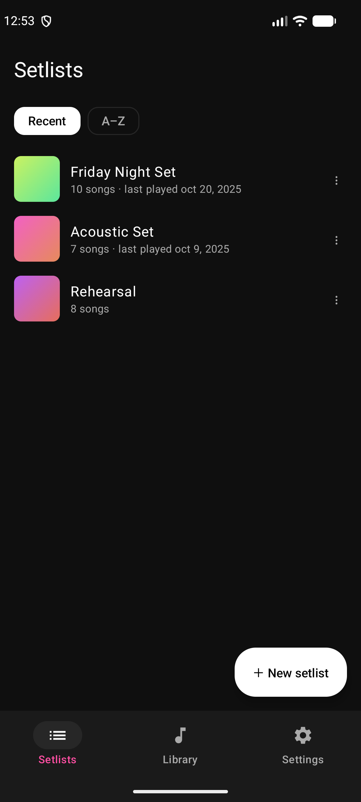
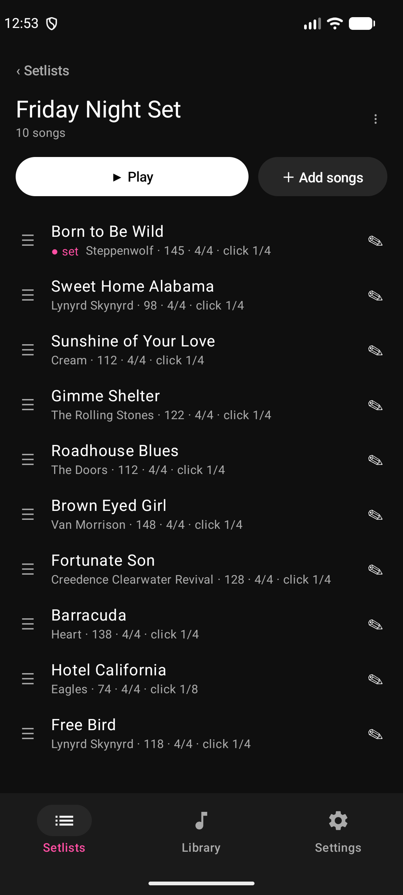
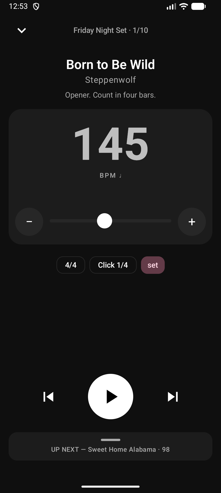
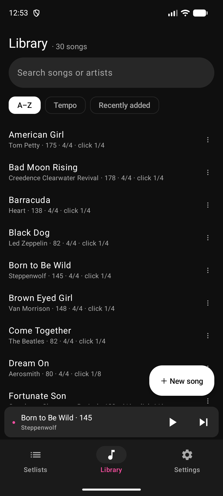
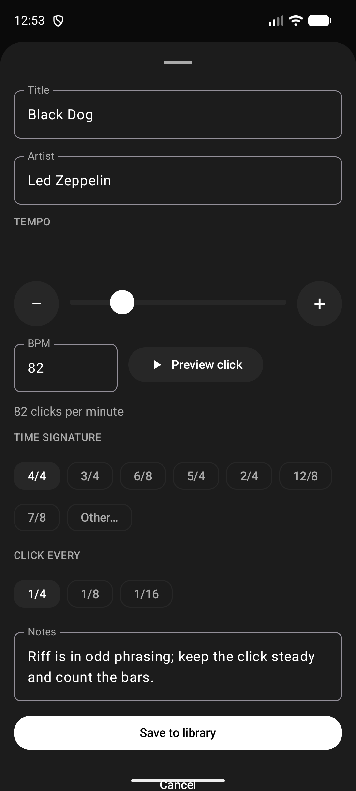

# jtmpo

An Android metronome built for gigging musicians. It plays a rock-steady click, even with the screen
off, and keeps your songs and their tempos in setlists, so you can step through a set without touching
the tempo control.

<p>
  
  
  
  
  
</p>

## What it does

- **A steady click.** Sample-accurate timing from a foreground service, so it keeps going with the
  screen off, the app in the background, or the phone locked. Tempos from 20 to 300 BPM.
- **Songs and setlists.** Keep every song's tempo, time signature, click pattern and notes in a
  library, and put songs in as many setlists as you like. Drag to reorder.
- **Per-setlist overrides.** Play a song slower in rehearsal, or leave a different note on it for one
  gig, without touching the library copy. Overrides are marked **set** in the list.
- **Easy playback.** Tap a song to load it, then step through the setlist with next and previous.
  "Up next" shows what is coming, and play and pause work from the lock screen and the notification.
- **Time signatures and subdivisions.** 4/4, 3/4, 6/8, 5/4, 7/8 and others, clicking quarters,
  eighths or sixteenths (dotted quarters in 6/8).
- **A visual pulse** for loud rooms, with an adjustable sync offset so the flash lines up with the
  click through your headphones.
- **Backups and import.** Export everything to a file, restore it later, and import setlists from
  Tempo (`.slist` and `.fzt` exports).
- **Made for in-ears.** The click pauses if the headphones are unplugged or disconnected, rather
  than blaring out of the phone speaker.

## Using it

1. **Add songs.** Library -> New song. Set the title, tempo, time signature and click pattern, add
   notes if you like (a capo position, a count-in), and tap Preview click to hear it.
2. **Make a setlist.** Setlists -> New setlist, then Add songs to pick from the library.
3. **Play.** Open a setlist and tap a song. Press play; next and previous move through the
   setlist, and the tempo can be nudged with the slider or by dragging on the tempo control.
4. **Change a song for one setlist.** Edit a song from inside a setlist and the change applies to
   that setlist only. Clear the override to go back to the library values.

Settings has the keep-awake switch, a screen flip for when the phone sits upside down on a stand,
the visual sync offset, and backup, restore and import.

### Importing from Tempo

Export one setlist from Tempo as a `.slist` file (or all of them as `.fzt`) and copy it to the
Downloads folder on your phone. In jtmpo, open Settings -> Import from Tempo, pick the file,
and review the preview. It shows which songs are new and which already exist, and flags any song
whose tempo or time signature differs between copies. Choose "Songs only" or "Songs and a setlist",
then confirm. Importing the same file twice does not duplicate anything. `docs/import-format.md`
describes exactly what is read.

### Backups

Settings -> Export backup saves one file through the system picker, so it can go to local storage
or a cloud provider. Restore from backup replaces everything in the app with that file and stops
playback.

## Building from source

jtmpo is Kotlin, Jetpack Compose and Material 3 (minSdk 26). It needs JDK 21 and the Android SDK.
The repo uses [mise](https://mise.jdx.dev) to provide both and [Task](https://taskfile.dev) to run
things:

```bash
mise exec -- task check     # lint and unit tests
mise exec -- task build     # assemble the debug APK
mise exec -- task install   # install it on a connected device or emulator
```

To try the app with data, load the demo library: see `demo/README.md`.

## More

- `docs/acceptance.md` is the manual checklist for things unit tests can't cover: phone calls,
  unplugging, screen-off drift.
- `docs/digital-sound.md` explains the click sound and how it is generated
  (`tools/synth_click.py`).
- `docs/import-format.md` covers the Tempo import.
- `docs/releasing.md` covers signed release builds.
- `AGENTS.md` has notes for AI coding agents working in the repo.

## License

MIT; see `LICENSE`.
